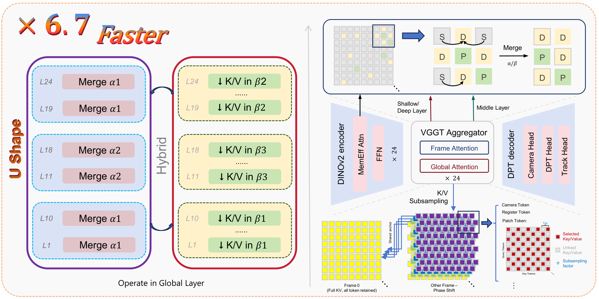

# RegimeVGGT

Code for **RegimeVGGT: Layer-Wise Spatially Preserving Redundancy Removal for Visual Geometry Grounded Transformer**.

[Paper](https://arxiv.org/abs/2606.18439) | [Method](https://arxiv.org/html/2606.18439v1#S3)

RegimeVGGT accelerates VGGT without training by combining saliency-guided token merging and selectively protected K/V downsampling. This repository exposes the final method described in Sections 3.2 and 3.3 of the linked paper.

<p align="center">
  
</p>

## method

The method uses the fixed policy below. Layer numbers are one-based.

| Global layers | Merge ratio | K/V sampling factor |
| --- | --- | --- |
| 1-10 | 0.99 | 1.5 |
| 11-18 | 0.50 | 1.3 |
| 19-24 | 0.99 | 1.7 |

- Frozen DINOv2 CLS attention selects the top 10% salient patches per frame. They are protected during merging and K/V sampling.
- Camera/register tokens and the first frame are retained; the spatial K/V grid is shifted by frame index.
- Merge indices are cached within the three bands. Layers 11-14 recompute their indices at each layer.
- Size-aware attention preserves merged-token multiplicity through an extra Q/K dimension and head-dimension padding.
- Every global layer uses the final merge-and-sample path; DPT taps retain full token resolution after unmerging.

The public method interface is:

```python
import torch
from methods.regimevggt import run_aggregator_regimevggt

# model: pretrained VGGT backbone in eval mode
# images: RGB in [0, 1], shaped [1, frames, 3, height, width]
with torch.no_grad():
    features, patch_start_idx = run_aggregator_regimevggt(model, images)
```

The returned features feed the existing VGGT camera, depth and point heads. The VGGT backbone and its head dependencies are retained for checkpoint compatibility.

## Installation

```bash
git clone https://github.com/Tracyou07/RegimeVGGT.git
cd RegimeVGGT
python -m pip install -r requirements.txt
```

The paper uses one NVIDIA H800 80 GB at input resolution 518 x 392.

## Checkpoint

The method uses Meta's `model_tracker_fixed_e20.pt` checkpoint without fine-tuning.

```bash
mkdir -p ckpt
wget -P ckpt \
  https://huggingface.co/facebook/VGGT_tracker_fixed/resolve/main/model_tracker_fixed_e20.pt
export CKPT="$PWD/ckpt/model_tracker_fixed_e20.pt"
```

The checkpoint remains subject to the [upstream VGGT terms](https://huggingface.co/facebook/VGGT_tracker_fixed).

## Evaluation

The public evaluator covers dense reconstruction on 7Scenes and NRGBD. Dataset locations, checkpoint paths, keyframe stride and output locations remain runtime inputs.

```bash
# 7Scenes and NRGBD reconstruction; KF can be 3 or 10
SEVEN_ROOT=/path/to/7scenes \
NRGBD_ROOT=/path/to/nrgbd \
KF=10 CKPT="$CKPT" bash scripts/eval_7andn.sh
```

The evaluator requires the original 7Scenes/NRGBD dataset adapters and metric packages (`data` and `utils`). These protocol dependencies are not bundled and must be supplied before evaluation.

Outputs are written to `results/regimevggt/<dataset>/kf_<stride>/`.

## Repository layout

```text
methods/        Final RegimeVGGT aggregator and token-merging primitive
vggt/           VGGT backbone, heads and evaluation utilities
eval/           7Scenes and NRGBD evaluation entry point
scripts/        7Scenes and NRGBD evaluation launcher
image/          Paper figures
```

## Citation

```bibtex
@misc{you2026regimevggt,
  title={RegimeVGGT: Layer-Wise Spatially Preserving Redundancy Removal for Visual Geometry Grounded Transformer},
  author={Jinhao You and Shuo Lyu and Zhuohang Lyu and Tanxuan Li and Zibo Zhao and Jiaxiang Hu and Kai Tang and Yichen Guo},
  year={2026},
  eprint={2606.18439},
  archivePrefix={arXiv},
  primaryClass={cs.CV},
  url={https://arxiv.org/abs/2606.18439}
}
```

## Acknowledgements and license

This implementation builds on VGGT and the FastVGGT token-merging primitive. Original copyright notices are retained.

Repository code is licensed under Apache-2.0; see `LICENSE`. The original VGGT code under `vggt/` and its weights remain subject to the upstream VGGT license.
